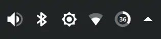
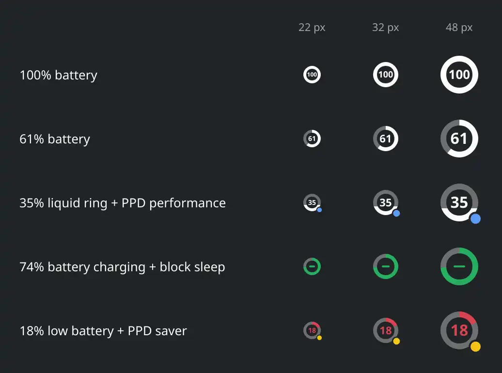
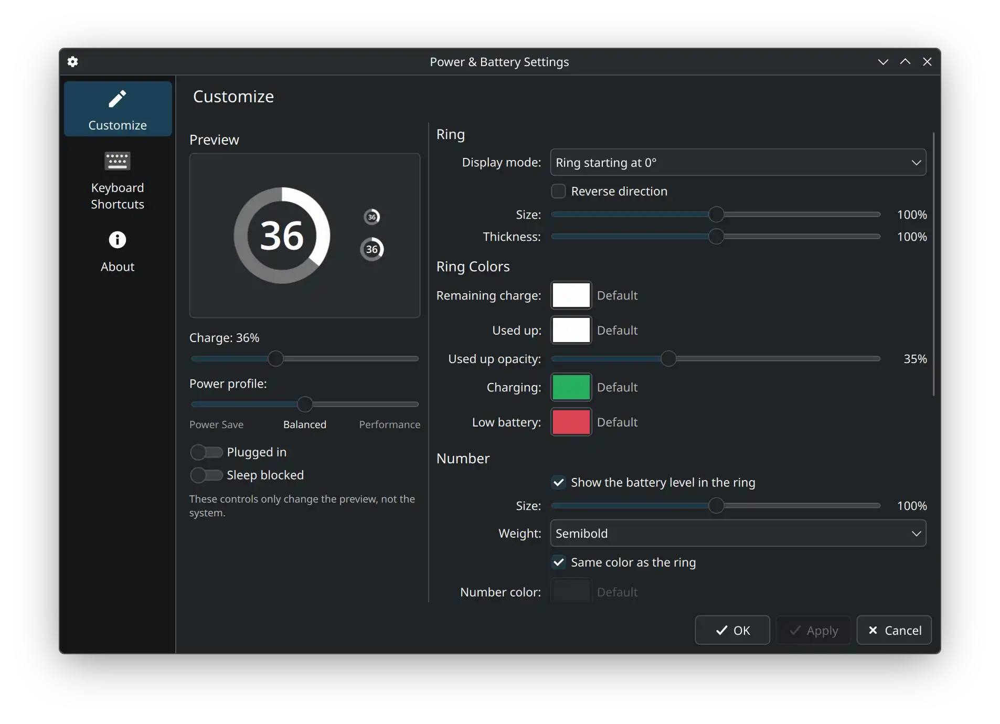

# Better KDE Battery



[KDE Store](https://store.kde.org/p/2381236/)

A fork of KDE Plasma's Power & Battery widget that keeps all of the original features while adding more battery styles and customization.

Best used together with the **[Papirus Icon Theme](https://github.com/PapirusDevelopmentTeam/papirus-icon-theme)**.

## Overview



- **Ring**: remaining charge
- **Ring color**: indicates low battery and charging
- **Number**: battery percentage
- **Power profile indicator**: shows power save and performance mode. Hidden in balanced mode or when power-profiles-daemon is not installed
- **Sleep blocked**: the number can be replaced with a dash

Devices without a battery still show the original icon.
The widget's name is the original name plus a suffix, so it sorts in the same place as the original widget in the system tray.


## Customization



Right-click the icon → "Customize…" to open the settings dialog:

- **Left**: live preview, with controls to adjust the preview
- **Right**:
  - Ring: display mode (ring starting at 0° / ring starting at 180° / liquid container), direction, size, thickness;
  - Ring colors: remaining charge, used-up charge and its opacity, charging, low battery;
  - Number: show or hide, size, weight, same color as the ring / custom color;
  - Behavior: low battery threshold, when to show the charging color, sleep blocked indicator;
  - Power profile indicator: on/off, size, position, colors;
  - "Restore Defaults".

All colors follow the color scheme by default (shown as "Default"). Custom settings are stored in the Plasma widget configuration (`config/main.xml`).
The configure button in the system tray popup works exactly like in the original Power & Battery widget.


## Compatibility

The widget is pure QML and needs no compiling. Its backend uses the modules that ship with Plasma, so it adapts to your system exactly like the original.

Plasma version:

- 6.7 – code baseline (6.7.5)
- 6.5, 6.6, 6.8 – should work
- ≤ 6.4 – **not supported**: different interfaces

Check your version: `plasmashell --version`


## Install / Update / Uninstall

Download and extract the repository, then run in its root directory:

```bash
# Install or update with the script in this repository
tools/install.sh --restart
```

```bash
# Install or update with KDE's own command (this clears the widget's data)
kpackagetool6 -t Plasma/Applet -u package
systemctl --user restart plasma-plasmashell
```

```bash
# Uninstall
kpackagetool6 -t Plasma/Applet -r io.github.fosvcat.betterkdebattery
```

To put Better KDE Battery in the system tray, right-click it and open "Configure System Tray", set Better KDE Battery to "Always shown", and set the original battery widget to "Disabled".


## Translations

- Strings taken over from the original widget use the system's installed translations of the original, through `i18nd("plasma_applet_org.kde.plasma.battery", …)`.
- Strings added by this project use their own translation domain. Translations live in `po/<lang>.po`, and the compiled `.mo` files ship with the package (`package/contents/locale/`).
  After changing strings or translations, run `tools/update-translations.sh`.


## Sources and License

| File in this repository | Upstream source |
|---|---|
| `package/contents/ui/*.qml`, `config/main.xml`, `metadata.json` | [powerdevil](https://invent.kde.org/plasma/powerdevil) `applets/batterymonitor/` |
| `package/contents/ui/BatteryIcon.qml` | [plasma-workspace](https://invent.kde.org/plasma/plasma-workspace) `components/workspace/BatteryIcon.qml` |

The upstream code is licensed under GPL-2.0-or-later / LGPL-2.0-or-later (see the SPDX header of each file). This project is released under GPL-2.0-or-later (see `LICENSE`).
